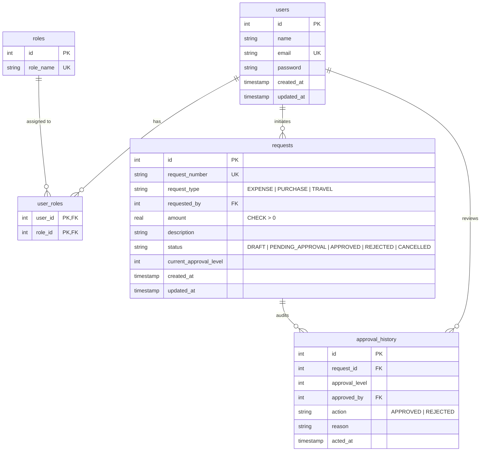

# 💎 FinFlow — Enterprise Multi-Level Financial Approval System

[](https://golang.org/)
[](https://angular.dev/)
[](https://modernc.org/sqlite)
[](https://www.postgresql.org/)
[](https://www.docker.com/)
[](https://gitlab.com/beinex-group1/financaial-approval-system)

---

## 📌 Executive Summary

**FinFlow** is an enterprise-grade financial expenditure management and authorization platform. Organizations frequently face risks of unauthorized spending, lack of budget visibility, compliance bottlenecks, and rogue purchases. FinFlow addresses this by enforcing a **strict, multi-tier approval workflow governed deterministically by monetary thresholds**.

Every financial outlay—whether an operational **Expense**, equipment **Purchase**, or corporate **Travel**—automatically determines its required review chain based on its requested amount. Reviews progress sequentially through authorized organizational roles (**Manager**, **Finance Department**, and **Board of Directors**), while enforcing strict governance rules such as **Self-Approval Prevention**, **Duplicate Action Prevention**, and a **Tamper-Evident Immutable Audit Log**.

---

## 🏛️ System Architecture

FinFlow is designed around Clean Architecture principles, ensuring complete decoupling between presentation, business rules, persistence, and external infrastructure.

```
                           +----------------------------------------+
                           |        Angular 18 Frontend UI          |
                           |   (Standalone Components, Dark Theme)  |
                           +-------------------+--------------------+
                                               |
                                     HTTP / JSON REST API
                                     (JWT Bearer Token)
                                               |
                           +-------------------v--------------------+
                           |             Go Backend                 |
                           |  +----------------------------------+  |
                           |  | HTTP Router & CORS Middleware    |  |
                           |  +----------------------------------+  |
                           |  | JWT Authentication & RBAC Guard  |  |
                           |  +----------------------------------+  |
                           |  | Threshold Engine & State Machine |  |
                           |  +----------------------------------+  |
                           |  | Repositories (Data Access Layer) |  |
                           |  +-----------------+----------------+  |
                           +--------------------|-------------------+
                                                |
                         +----------------------+----------------------+
                         |                                             |
                         v                                             v
          +-------------------------------+             +-------------------------------+
          |   Embedded SQLite (Default)   |             |    PostgreSQL 16 (Optional)   |
          |  Zero setup, pure Go driver   |             |  Enterprise scale, Dockerized |
          +-------------------------------+             +-------------------------------+
```

### Architectural Highlights

| Dimension | Implementation | Technical Advantage |
|---|---|---|
| **Backend Language** | Go (Golang 1.23+) | Sub-millisecond latency, minimal memory footprint, single compiled binary. |
| **Frontend Framework** | Angular 18 (Standalone) | Strictly-typed TypeScript, reactive signal-ready architecture, high performance bundle. |
| **Dual Database Engine** | Pure-Go SQLite & PostgreSQL | Runs out-of-the-box locally with embedded SQLite (`modernc.org/sqlite`) without installing any database software, while retaining full 100% compatibility with PostgreSQL in Docker/Production. |
| **Security & Auth** | JWT (HMAC-SHA256) + Bcrypt | Stateless authentication with role claims, secure salted password hashes (cost 10). |
| **State Machine** | Sequential Transaction Engine | Strict validation preventing race conditions, duplicate approvals, and unauthorized stage skipping. |

---

## ⚖️ Core Business Rules & Threshold Matrix

### 1. Monetary Threshold Hierarchy

The system automatically calculates the approval hierarchy dynamically as soon as an amount is entered:

```
                                  [ Financial Request Created ]
                                                |
                               +----------------+---------------+
                               |                                |
                        Amount < ₹10,000                Amount >= ₹10,000
                               |                                |
                        +------v------+                 +-------v-------+
                        |   TIER 1    |                 |   TIER 2 & 3  |
                        |   Level 1   |                 |    Level 1    |
                        |  (Manager)  |                 |   (Manager)   |
                        +------+------+                 +-------+-------+
                               |                                |
                            APPROVED                         APPROVED
                               |                                |
                        +------v------+                 +-------v-------+
                        |    FULLY    |                 |    Level 2    |
                        |   APPROVED  |                 |   (Finance)   |
                        +-------------+                 +-------+-------+
                                                                |
                                                +---------------+---------------+
                                                |                               |
                                         Amount <= ₹50,000               Amount > ₹50,000
                                                |                               |
                                             APPROVED                        APPROVED
                                                |                               |
                                         +------v------+                 +-------v-------+
                                         |    FULLY    |                 |    Level 3    |
                                         |   APPROVED  |                 |  (Director)   |
                                         +-------------+                 +-------+-------+
                                                                                 |
                                                                              APPROVED
                                                                                 |
                                                                         +-------v-------+
                                                                         |     FULLY     |
                                                                         |   APPROVED    |
                                                                         +---------------+
```

| Tier | Request Range | Required Approval Levels | Approval Sequence | Reviewers Involved |
|---|---|:---:|---|---|
| **Tier 1** | **< ₹10,000** | **1** | Level 1 | **Manager** only |
| **Tier 2** | **₹10,000 – ₹50,000** | **2** | Level 1 → Level 2 | **Manager** then **Finance** |
| **Tier 3** | **> ₹50,000** | **3** | Level 1 → Level 2 → Level 3 | **Manager** then **Finance** then **Director** |

---

### 2. Strict Governance & Validation Rules

1. **🚫 Self-Approval Prevention:**
   A user can never approve or reject their own financial requests (`requested_by != approver_id`). If a Manager or Director creates an expense, they are barred from signing off on it.
2. **🚫 Duplicate Approval Prevention:**
   The exact same approval tier cannot be authorized more than once on the same request.
3. **⏩ Sequential Progression:**
   Higher levels cannot approve out of order. Level 2 (Finance) is locked until Level 1 (Manager) approves. Level 3 (Director) is locked until Level 2 (Finance) approves.
4. **❗ Mandatory Rejection Reason:**
   Rejection terminates the approval chain immediately. The reviewer **must** provide a detailed explanatory reason, which is permanently logged in the audit trail.
5. **📜 Tamper-Evident Audit Trail:**
   Every approval and rejection records the reviewer's User ID, Name, Role, Timestamp, Action (`APPROVED` or `REJECTED`), and comments into `approval_history`.

---

## 👥 Pre-Configured Test Accounts

The database comes pre-seeded with 4 user accounts representing all key corporate roles. All accounts use the standard password: `password`.

| User Name | Email Address | Password | Assigned Roles | Capabilities |
|---|---|---|---|---|
| **Alice Employee** | `employee@company.com` | `password` | `EMPLOYEE` | Create requests, view personal history, cancel pending drafts. |
| **Bob Manager** | `manager@company.com` | `password` | `EMPLOYEE`, `MANAGER` | Review Level 1 requests (< ₹10k and initial step for > ₹10k). |
| **Carol Finance** | `finance@company.com` | `password` | `EMPLOYEE`, `FINANCE` | Review Level 2 requests (₹10k – ₹50k and Tier 3 second step). |
| **David Director** | `director@company.com` | `password` | `EMPLOYEE`, `DIRECTOR` | Final executive sign-off for Level 3 high-value requests (> ₹50k). |

> ⚡ **Quick Demo Login:** On the web login screen (`http://localhost:4200/login`), you can click any of the **1-Click Quick Demo Sign-In Buttons** to instantly log in as any role without typing.

---

## 💻 Tech Stack & Dependencies

### Backend
- **Go 1.23+**
- **ModernC Pure-Go SQLite (`modernc.org/sqlite v1.61.0`)**: 100% CGO-free, embedded, cross-platform SQLite driver.
- **Lib/PQ (`github.com/lib/pq v1.10.9`)**: PostgreSQL driver.
- **Golang JWT (`github.com/golang-jwt/jwt/v5 v5.2.1`)**: Signed JSON Web Token generation and claims extraction.
- **Bcrypt (`golang.org/x/crypto v0.32.0`)**: Industry-standard cryptographic password hashing.

### Frontend
- **Angular 18.2+** (Standalone Components, `provideHttpClient(withInterceptors(...))`, Angular Router with Functional Guards).
- **TypeScript 5.5+**
- **SCSS Design System**: Modern dark glassmorphic styling, custom glowing cards, animated status badges, responsive layouts.
- **RxJS 7.8+**: Reactive state streams for real-time auth and data sync.

---

## 🗄️ Database Schema & Entity Relationships



---

## 🚀 Quickstart & Setup Guide

### Option 1: Zero-Dependency Local Run (Recommended)

No Docker or PostgreSQL installation needed! The system uses pure-Go SQLite out-of-the-box.

#### 1. Start the Go Backend API
```powershell
# Navigate to backend directory
cd financial-approval-system\backend

# Run precompiled binary directly
.\server.exe

# Or compile and run from Go source:
# & "$env:USERPROFILE\go\bin\go.exe" run ./cmd/server
```

- API Server listens at: **`http://localhost:8085`**
- Health check verification: **`http://localhost:8085/api/health`**
- Database file `financial_approval.db` is auto-created with tables and seed data upon launch.

#### 2. Start the Angular Frontend UI
In a separate terminal window:
```powershell
# Navigate to frontend directory
cd financial-approval-system\frontend

# Start Angular local development server
npm start
```

- Open your browser at: **`http://localhost:4200`**
- Click any of the **1-Click Demo Account Buttons** on the sign-in page to start testing!

---

### Option 2: Docker Compose (PostgreSQL + Multi-Stage Containers)

If you have Docker Desktop installed and want to run the full containerized stack:

```bash
cd financial-approval-system
docker-compose up --build
```

- **Frontend Application:** `http://localhost:4200`
- **Go Backend API:** `http://localhost:8085`
- **PostgreSQL Database:** `localhost:5432`

---

## 📡 Complete REST API Documentation

Base URL: `http://localhost:8085/api`

### 1. Authentication Endpoints

#### Register User
- **POST** `/auth/register`
- **Body:**
  ```json
  {
    "name": "Jane Doe",
    "email": "jane@company.com",
    "password": "securepassword123"
  }
  ```
- **Response:** `201 Created` with JWT token and user profile. Default role `EMPLOYEE` is assigned.

#### Login User
- **POST** `/auth/login`
- **Body:**
  ```json
  {
    "email": "manager@company.com",
    "password": "password"
  }
  ```
- **Response:** `200 OK`
  ```json
  {
    "token": "eyJhbGciOiJIUzI1NiIsIn...",
    "user": {
      "id": 2,
      "name": "Bob Manager",
      "email": "manager@company.com",
      "roles": ["EMPLOYEE", "MANAGER"]
    }
  }
  ```

#### Current Profile
- **GET** `/auth/me`
- **Header:** `Authorization: Bearer <token>`
- **Response:** `200 OK` with user details and assigned roles.

---

### 2. Financial Request Endpoints

#### List User Requests
- **GET** `/requests`
- **Header:** `Authorization: Bearer <token>`
- **Response:** `200 OK` — Returns list of all requests submitted by the logged-in user.

#### Create Financial Request
- **POST** `/requests`
- **Header:** `Authorization: Bearer <token>`
- **Body:**
  ```json
  {
    "request_type": "EXPENSE",
    "amount": 28500.00,
    "description": "Ergonomic dual 4K monitors for developers",
    "submit": true
  }
  ```
  *(Set `"submit": false` to save as `DRAFT`, or `true` to immediately submit for approval)*
- **Response:** `201 Created`

#### Get Request Details with Audit History
- **GET** `/requests/{id}`
- **Header:** `Authorization: Bearer <token>`
- **Response:** `200 OK` — Full request object including `history: [...]` audit log.

#### Update Draft Request
- **PUT** `/requests/{id}`
- **Header:** `Authorization: Bearer <token>`
- **Response:** `200 OK` (Only allowed if request is still in `DRAFT` status).

#### Cancel Request
- **POST** `/requests/{id}/cancel`
- **Header:** `Authorization: Bearer <token>`
- **Response:** `200 OK` (Cancels request; only creator can cancel).

---

### 3. Approval Workflow Endpoints

#### Get Pending Approvals for Current Reviewer
- **GET** `/approvals/pending`
- **Header:** `Authorization: Bearer <token>`
- **Response:** `200 OK` — Returns requests currently waiting at the caller's authorized approval level, strictly excluding requests created by the caller themselves.

#### Process Approval or Rejection
- **POST** `/approvals/{id}/action`
- **Header:** `Authorization: Bearer <token>`
- **Body:**
  ```json
  {
    "action": "APPROVED",
    "reason": "Budget validated and approved."
  }
  ```
  *Or for rejection:*
  ```json
  {
    "action": "REJECTED",
    "reason": "Exceeds department entertainment allowance. Please resubmit under travel expense."
  }
  ```
- **Response:** `200 OK` — Advances to next level or marks `APPROVED` / `REJECTED`.

#### View Audit Trail
- **GET** `/approvals/{id}/history`
- **Header:** `Authorization: Bearer <token>`
- **Response:** `200 OK` — Array of historical review entries.

---

### 4. Analytics & Reports Endpoints

#### Dashboard KPI Summary
- **GET** `/analytics/summary`
- **Header:** `Authorization: Bearer <token>`
- **Response:** `200 OK`
  ```json
  {
    "total_requests": 15,
    "pending_requests": 3,
    "approved_requests": 10,
    "rejected_requests": 2,
    "total_amount": 348500.00,
    "approved_amount": 260000.00,
    "pending_amount": 73500.00
  }
  ```

#### Category Spending Breakdown
- **GET** `/analytics/categories`
- Returns metrics grouped by `EXPENSE`, `PURCHASE`, and `TRAVEL`.

#### Monetary Tier Breakdown
- **GET** `/analytics/tiers`
- Returns counts and total sums across Tier 1, Tier 2, and Tier 3.

#### Filtered Report Export
- **GET** `/analytics/reports?status=APPROVED&type=EXPENSE&min_amount=1000`
- Query parameters: `status`, `type`, `min_amount`, `max_amount`, `start_date`, `end_date`.

---

## 📂 Project Directory Structure

```
financial-approval-system/
├── README.md                      # Comprehensive project documentation
├── docker-compose.yml             # Container orchestration (Go + Angular + PostgreSQL)
├── .gitignore                     # Git ignore rules for node_modules, binaries, db
│
├── backend/                       # Go Backend API
│   ├── cmd/
│   │   └── server/
│   │       └── main.go            # Application entry point & migration runner
│   ├── internal/
│   │   ├── config/
│   │   │   └── config.go          # Dual driver config (SQLite default + PostgreSQL)
│   │   ├── handlers/
│   │   │   ├── auth_handler.go    # User registration & login handlers
│   │   │   ├── request_handler.go # Financial request CRUD handlers
│   │   │   ├── approval_handler.go# Review workflow action handlers
│   │   │   └── analytics_handler.go# Metrics, KPI, and reporting handlers
│   │   ├── middleware/
│   │   │   └── auth.go            # JWT authentication & CORS middleware
│   │   ├── models/
│   │   │   ├── user.go            # User & role structs
│   │   │   ├── request.go         # Request struct & threshold calculation logic
│   │   │   ├── request_test.go    # Unit tests for threshold business rules
│   │   │   └── analytics.go       # KPI summary & report filter structs
│   │   ├── repository/
│   │   │   ├── user_repository.go # User persistence operations
│   │   │   ├── request_repository.go # Financial requests database queries
│   │   │   ├── approval_repository.go# Transaction-safe approval engine
│   │   │   ├── analytics_repository.go# Aggregation queries for dashboard
│   │   │   └── sqlite_test.go     # In-memory SQLite end-to-end integration test
│   │   └── routes/
│   │       └── routes.go          # HTTP route multiplexer
│   ├── migrations/
│   │   ├── sqlite_init.sql        # SQLite schema & seed data (used locally)
│   │   ├── 001_init.sql           # PostgreSQL initial schema
│   │   └── 002_seed_users.sql     # PostgreSQL seed data
│   ├── Dockerfile                 # Multi-stage production container build
│   ├── server.exe                 # Ready-to-run compiled Windows executable
│   ├── go.mod                     # Go module definitions
│   └── go.sum                     # Checksum hashes
│
└── frontend/                      # Angular 18 Single Page Application
    ├── src/
    │   ├── app/
    │   │   ├── core/
    │   │   │   ├── guards/        # authGuard & loginGuard route protection
    │   │   │   ├── interceptors/  # JWT HTTP Bearer token injector
    │   │   │   ├── models.ts      # TypeScript interfaces
    │   │   │   └── services/      # AuthService, RequestService, AnalyticsService
    │   │   ├── features/
    │   │   │   ├── auth/          # Login & Register with 1-click demo buttons
    │   │   │   ├── dashboard/     # Metric cards, tier breakdown, quick actions
    │   │   │   ├── requests/      # Request creation form, list, and detail views
    │   │   │   ├── approvals/     # Approval queue with approve/reject modals
    │   │   │   └── reports/       # Filterable data tables with CSV download
    │   │   ├── app.component.ts   # Navigation bar & layout shell
    │   │   └── app.routes.ts      # Client-side route declarations
    │   ├── styles.scss            # Global dark glassmorphism theme & CSS variables
    │   └── index.html             # Application entry point
    ├── angular.json               # Angular CLI configuration & build budgets
    ├── Dockerfile                 # Multi-stage Angular build with Nginx
    ├── nginx.conf                 # Nginx SPA reverse proxy configuration
    └── package.json               # Frontend dependencies & build scripts
```

---

## 🧪 Testing & Verification

### 1. Backend Business Rule Unit Tests
Run unit tests verifying monetary threshold matrix calculations:
```powershell
cd backend
go test -v ./internal/models
```
**Test Coverage:**
- Amounts < ₹10,000 require exactly 1 level (`Manager`).
- Boundary value ₹9,999.99 requires 1 level.
- Border value ₹10,000 requires 2 levels (`Manager` → `Finance`).
- Amounts between ₹10,000 and ₹50,000 require 2 levels.
- Border value ₹50,000 requires 2 levels.
- Amounts > ₹50,000 require 3 levels (`Manager` → `Finance` → `Director`).

### 2. In-Memory SQLite Integration Tests
Run end-to-end repository integration tests across users, requests, approvals, and analytics:
```powershell
cd backend
go test -v ./internal/repository
```

### 3. Frontend Production Build Verification
Verify compilation and style budgets:
```powershell
cd frontend
npm run build
```

---

## 🔗 Repository Information

- **GitLab Project:** [https://gitlab.com/beinex-group1/financaial-approval-system](https://gitlab.com/beinex-group1/financaial-approval-system)
- **Main Branch:** `main`
- **License:** MIT License

---

*Engineered with precision for secure, compliant, and transparent financial operations.*
